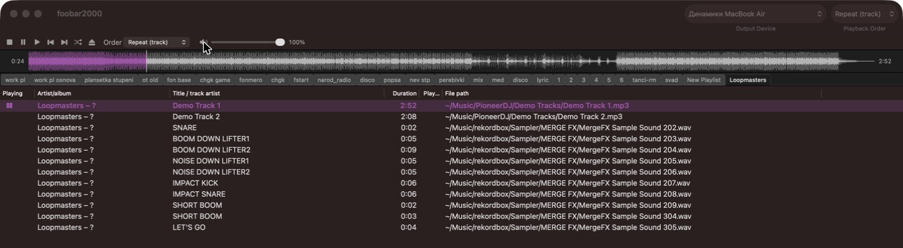
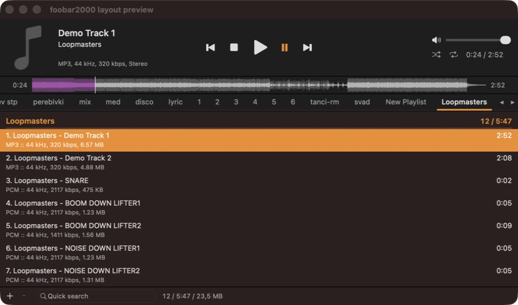

# foobar2000 plugins for macOS

Three components for [foobar2000 for Mac](https://www.foobar2000.org/mac) 2.x (Apple Silicon and Intel):

| Plugin | What it does | Layout elements |
|---|---|---|
| **Waveform Seekbar** (`foo_wave_seekbar`) | Seekbar showing the track's waveform, time tooltip on hover, optional elapsed/total time at the sides | `waveform-seekbar`, `waveform-seekbar time=sides` |
| **Classic UI** (`foo_classic_ui`) | foobar2000-for-Windows look: toolbar with volume, playlist tabs, playlist with columns/sorting/grouping, status bar, library search, playback queue, playlist locks, themes | `classic-toolbar`, `classic-tabs`, `classic-playlist`, `classic-statusbar` |
| **AIMP UI** (`foo_aimp_ui`) | AIMP-style header, tabs, grouped two-line playlist and footer | `aimp-header`, `aimp-tabs`, `aimp-playlist`, `aimp-footer` |

Downloads and descriptions in Russian: **https://nanor.ru/foobar2000-mac-plugins/**




## Install

1. Download the `.fb2k-component` files from the site (or build them, see below).
2. The plugins are not signed by Apple, so remove the quarantine flag first:
   ```sh
   xattr -dr com.apple.quarantine *.fb2k-component
   ```
3. Double-click each file, or foobar2000 → Settings → Components → «+», then restart foobar2000.
4. View → Layout → Edit Layout, paste a layout, Apply:

   Windows-like:
   ```
   splitter horizontal style=thin
    classic-toolbar
    waveform-seekbar time=sides
    classic-tabs
    classic-playlist
    classic-statusbar
   ```
   AIMP-like:
   ```
   splitter horizontal style=thin
    aimp-header
    waveform-seekbar time=sides
    aimp-tabs
    aimp-playlist
    aimp-footer
   ```

Installed plugins check `https://nanor.ru/foobar/updates.json` once a day and can update themselves (download, SHA-256 check, restart). Manual check: File → Check for Plugin Updates… (Classic UI).

## Build

Requires Xcode. The repository is a complete build tree: the [foobar2000 SDK](https://www.foobar2000.org/SDK) (2026-09-17) is included unchanged, the plugins live next to its sample projects.

```sh
cd foobar2000/foo_classic_ui
xcodebuild -workspace foo_classic_ui.xcworkspace -scheme foo_classic_ui -configuration Release \
  ARCHS="arm64 x86_64" ONLY_ACTIVE_ARCH=NO build
```

Or open `foobar2000/<plugin>/<plugin>.xcworkspace` in Xcode. The built bundle is `<plugin>.component`; to install it by hand, copy it to `~/Library/foobar2000-v2/user-components/<plugin>/`.

A `.fb2k-component` package is a zip with the bundle under `mac/`:

```sh
mkdir -p pkg/mac && cp -R path/to/foo_classic_ui.component pkg/mac/
(cd pkg && zip -qry ../foo_classic_ui.fb2k-component mac)
```

## Layout of this repository

```
foobar2000/foo_wave_seekbar/   Waveform Seekbar  (Mac/WaveSeekbar.mm)
foobar2000/foo_classic_ui/     Classic UI        (Mac/ClassicUI.mm)
foobar2000/foo_aimp_ui/        AIMP UI           (Mac/AimpUI.mm)
foobar2000/nanor_shared/       update check / auto-install shared by the plugins
foobar2000/SDK, helpers, …     foobar2000 SDK (unchanged)
pfc/, libPPUI/                 SDK libraries (unchanged)
release/release.sh             build, package and publish to nanor.ru
```

Each plugin's version is in `foobar2000/<plugin>/version.h`.

`release/release.sh` builds all plugins, packages them and uploads the ones whose version changed. It needs `NANOR_DEPLOY_HOST` and `NANOR_DEPLOY_WEBROOT`, set in the environment or in `release/deploy.env` (not committed).

## License

The plugins (everything under `foobar2000/foo_wave_seekbar`, `foobar2000/foo_classic_ui`, `foobar2000/foo_aimp_ui`, `foobar2000/nanor_shared` and `release/`) are MIT-licensed, see [LICENSE](LICENSE).

The foobar2000 SDK is © Peter Pawlowski and distributed under its own license, see [sdk-license.txt](sdk-license.txt); `pfc` and `libPPUI` have their own license files.
